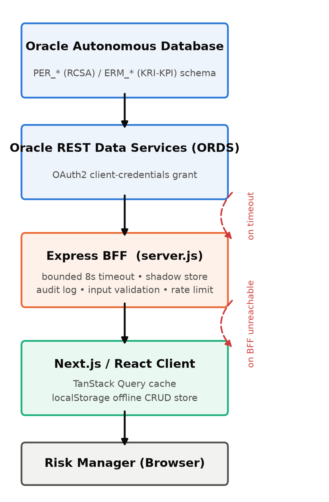
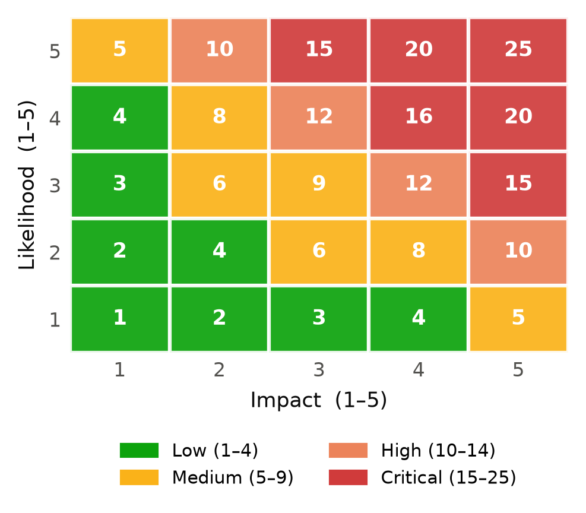
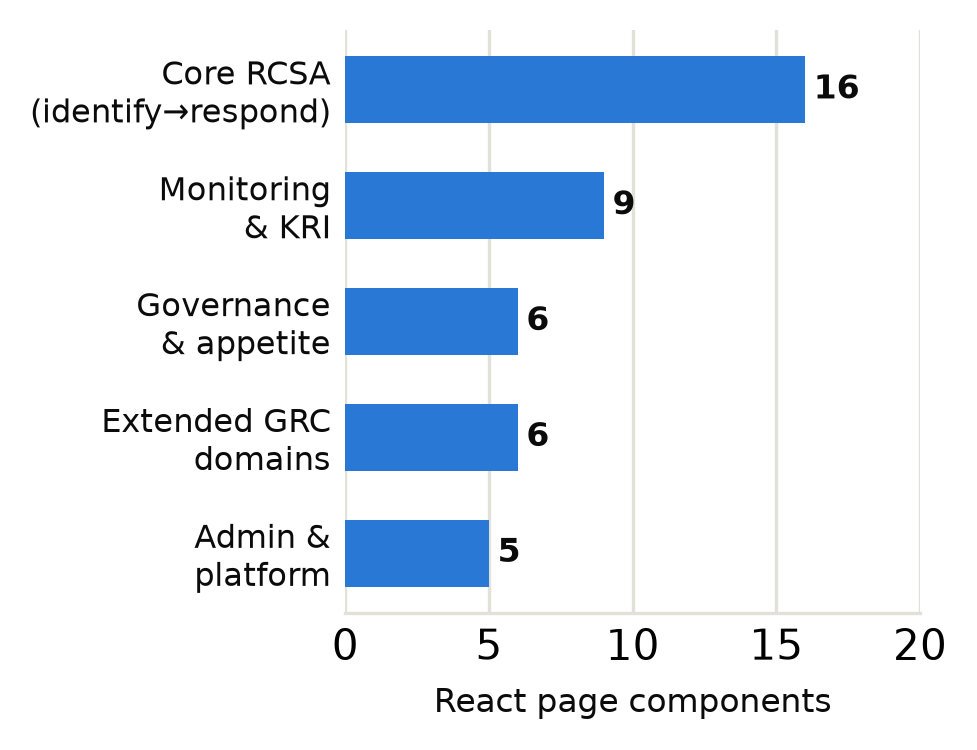
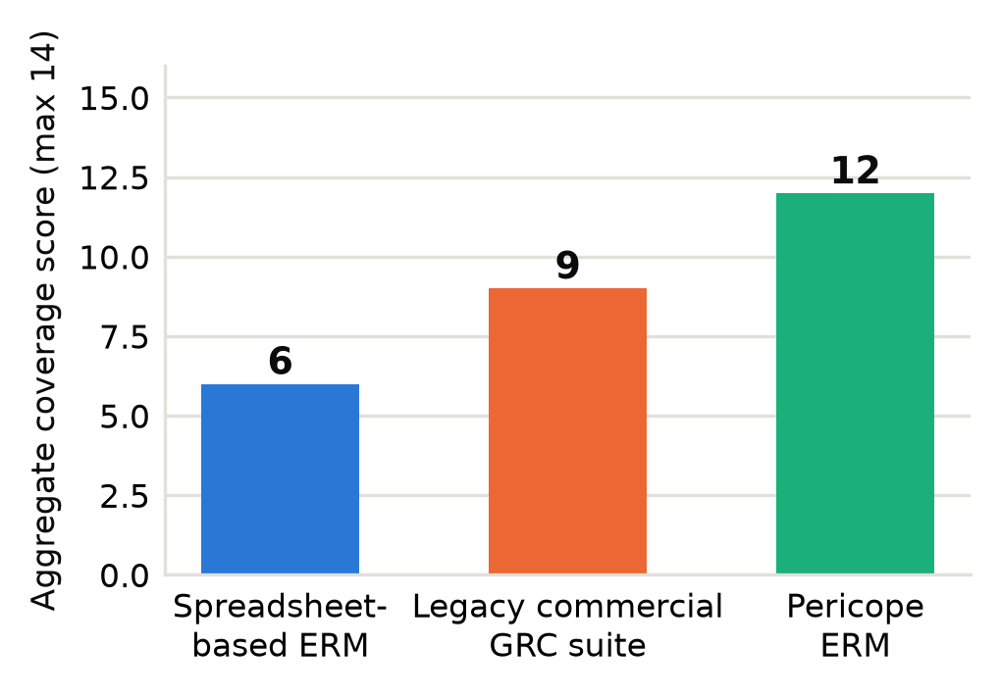

```{=openxml}
<w:tbl><w:tblPr><w:tblW w:type="pct" w:w="5000"/><w:tblBorders><w:top w:val="none"/><w:left w:val="none"/><w:bottom w:val="none"/><w:right w:val="none"/><w:insideH w:val="none"/><w:insideV w:val="none"/></w:tblBorders><w:tblLayout w:type="fixed"/><w:tblLook w:firstRow="0" w:lastRow="0" w:firstColumn="0" w:lastColumn="0" w:noHBand="1" w:noVBand="1" w:val="0000"/></w:tblPr><w:tblGrid><w:gridCol w:w="1667"/><w:gridCol w:w="1667"/><w:gridCol w:w="1667"/></w:tblGrid><w:tr><w:tc><w:tcPr><w:tcW w:type="pct" w:w="1667"/><w:tcBorders><w:top w:val="none"/><w:left w:val="none"/><w:bottom w:val="none"/><w:right w:val="none"/></w:tcBorders><w:vAlign w:val="top"/></w:tcPr><w:p><w:pPr><w:jc w:val="center"/><w:spacing w:after="0"/></w:pPr><w:r><w:rPr><w:b/></w:rPr><w:t xml:space="preserve">Srivatsan B</w:t></w:r></w:p><w:p><w:pPr><w:jc w:val="center"/><w:spacing w:after="0"/></w:pPr><w:r><w:rPr><w:sz w:val="18"/></w:rPr><w:t xml:space="preserve">1AT23CG104</w:t></w:r></w:p><w:p><w:pPr><w:jc w:val="center"/><w:spacing w:after="0"/></w:pPr><w:r><w:rPr><w:i/></w:rPr><w:t xml:space="preserve">Dept of Computer Science and Engineering</w:t></w:r></w:p><w:p><w:pPr><w:jc w:val="center"/><w:spacing w:after="0"/></w:pPr><w:r><w:t xml:space="preserve">Atria Institute of Technology</w:t></w:r></w:p><w:p><w:pPr><w:jc w:val="center"/><w:spacing w:after="0"/></w:pPr><w:r><w:t xml:space="preserve">Bengaluru, India</w:t></w:r></w:p><w:p><w:pPr><w:jc w:val="center"/><w:spacing w:after="120"/></w:pPr><w:r><w:t xml:space="preserve">srivatsan359@gmail.com</w:t></w:r></w:p></w:tc><w:tc><w:tcPr><w:tcW w:type="pct" w:w="1667"/><w:tcBorders><w:top w:val="none"/><w:left w:val="none"/><w:bottom w:val="none"/><w:right w:val="none"/></w:tcBorders><w:vAlign w:val="top"/></w:tcPr><w:p><w:pPr><w:jc w:val="center"/><w:spacing w:after="0"/></w:pPr><w:r><w:rPr><w:b/></w:rPr><w:t xml:space="preserve">Veena S</w:t></w:r></w:p><w:p><w:pPr><w:jc w:val="center"/><w:spacing w:after="0"/></w:pPr><w:r><w:rPr><w:i/></w:rPr><w:t xml:space="preserve">Assistant Professor, Dept of Computer Science and Engineering</w:t></w:r></w:p><w:p><w:pPr><w:jc w:val="center"/><w:spacing w:after="0"/></w:pPr><w:r><w:t xml:space="preserve">Atria Institute of Technology</w:t></w:r></w:p><w:p><w:pPr><w:jc w:val="center"/><w:spacing w:after="0"/></w:pPr><w:r><w:t xml:space="preserve">Bengaluru, India</w:t></w:r></w:p><w:p><w:pPr><w:jc w:val="center"/><w:spacing w:after="120"/></w:pPr><w:r><w:t xml:space="preserve">veena_cse@atria.edu.in</w:t></w:r></w:p></w:tc><w:tc><w:tcPr><w:tcW w:type="pct" w:w="1667"/><w:tcBorders><w:top w:val="none"/><w:left w:val="none"/><w:bottom w:val="none"/><w:right w:val="none"/></w:tcBorders><w:vAlign w:val="top"/></w:tcPr><w:p><w:pPr><w:jc w:val="center"/><w:spacing w:after="0"/></w:pPr><w:r><w:rPr><w:b/></w:rPr><w:t xml:space="preserve">Raja Vishnu</w:t></w:r></w:p><w:p><w:pPr><w:jc w:val="center"/><w:spacing w:after="0"/></w:pPr><w:r><w:rPr><w:sz w:val="18"/></w:rPr><w:t xml:space="preserve">1AT23CG080</w:t></w:r></w:p><w:p><w:pPr><w:jc w:val="center"/><w:spacing w:after="0"/></w:pPr><w:r><w:rPr><w:i/></w:rPr><w:t xml:space="preserve">Dept of Computer Science and Engineering</w:t></w:r></w:p><w:p><w:pPr><w:jc w:val="center"/><w:spacing w:after="0"/></w:pPr><w:r><w:t xml:space="preserve">Atria Institute of Technology</w:t></w:r></w:p><w:p><w:pPr><w:jc w:val="center"/><w:spacing w:after="0"/></w:pPr><w:r><w:t xml:space="preserve">Bengaluru, India</w:t></w:r></w:p><w:p><w:pPr><w:jc w:val="center"/><w:spacing w:after="120"/></w:pPr><w:r><w:t xml:space="preserve">rajavishnuuu36911@gmail.com</w:t></w:r></w:p></w:tc></w:tr><w:tr><w:tc><w:tcPr><w:tcW w:type="pct" w:w="1667"/><w:tcBorders><w:top w:val="none"/><w:left w:val="none"/><w:bottom w:val="none"/><w:right w:val="none"/></w:tcBorders><w:vAlign w:val="top"/></w:tcPr><w:p><w:pPr><w:jc w:val="center"/><w:spacing w:after="0"/></w:pPr><w:r><w:rPr><w:b/></w:rPr><w:t xml:space="preserve">Rithvik R</w:t></w:r></w:p><w:p><w:pPr><w:jc w:val="center"/><w:spacing w:after="0"/></w:pPr><w:r><w:rPr><w:sz w:val="18"/></w:rPr><w:t xml:space="preserve">1AT23CG084</w:t></w:r></w:p><w:p><w:pPr><w:jc w:val="center"/><w:spacing w:after="0"/></w:pPr><w:r><w:rPr><w:i/></w:rPr><w:t xml:space="preserve">Dept of Computer Science and Engineering</w:t></w:r></w:p><w:p><w:pPr><w:jc w:val="center"/><w:spacing w:after="0"/></w:pPr><w:r><w:t xml:space="preserve">Atria Institute of Technology</w:t></w:r></w:p><w:p><w:pPr><w:jc w:val="center"/><w:spacing w:after="0"/></w:pPr><w:r><w:t xml:space="preserve">Bengaluru, India</w:t></w:r></w:p><w:p><w:pPr><w:jc w:val="center"/><w:spacing w:after="120"/></w:pPr><w:r><w:t xml:space="preserve">rithvikravindranath@gmail.com</w:t></w:r></w:p></w:tc><w:tc><w:tcPr><w:tcW w:type="pct" w:w="1667"/><w:tcBorders><w:top w:val="none"/><w:left w:val="none"/><w:bottom w:val="none"/><w:right w:val="none"/></w:tcBorders><w:vAlign w:val="top"/></w:tcPr><w:p><w:pPr><w:jc w:val="center"/><w:spacing w:after="0"/></w:pPr><w:r><w:rPr><w:b/></w:rPr><w:t xml:space="preserve">Niranthar M Javagal</w:t></w:r></w:p><w:p><w:pPr><w:jc w:val="center"/><w:spacing w:after="0"/></w:pPr><w:r><w:rPr><w:sz w:val="18"/></w:rPr><w:t xml:space="preserve">1AT23CG071</w:t></w:r></w:p><w:p><w:pPr><w:jc w:val="center"/><w:spacing w:after="0"/></w:pPr><w:r><w:rPr><w:i/></w:rPr><w:t xml:space="preserve">Dept of Computer Science and Engineering</w:t></w:r></w:p><w:p><w:pPr><w:jc w:val="center"/><w:spacing w:after="0"/></w:pPr><w:r><w:t xml:space="preserve">Atria Institute of Technology</w:t></w:r></w:p><w:p><w:pPr><w:jc w:val="center"/><w:spacing w:after="0"/></w:pPr><w:r><w:t xml:space="preserve">Bengaluru, India</w:t></w:r></w:p><w:p><w:pPr><w:jc w:val="center"/><w:spacing w:after="120"/></w:pPr><w:r><w:t xml:space="preserve">nmjavagal@gmail.com</w:t></w:r></w:p></w:tc><w:tc><w:tcPr><w:tcW w:type="pct" w:w="1667"/><w:tcBorders><w:top w:val="none"/><w:left w:val="none"/><w:bottom w:val="none"/><w:right w:val="none"/></w:tcBorders></w:tcPr><w:p/></w:tc></w:tr></w:tbl>
```

# Introduction

Any organization past a certain size is sitting on a portfolio of operational, financial,
compliance, and strategic risks that need to be identified, scored, treated, and revisited on
some kind of cycle. What has actually changed over the last two decades is how seriously
regulators expect that cycle to be documented. The Sarbanes-Oxley Act requires public companies
to attest to the design and operating effectiveness of their internal controls over financial
reporting [3]. ISO 31000 lays out an internationally recognized process for identifying,
analyzing, evaluating, and treating risk [1], and the COSO Enterprise Risk Management framework
pushes further still, tying risk appetite explicitly to strategy and performance [2]. None of
these frameworks tell an organization which software to run; all three simply expect evidence,
who assessed a given risk, when, against what criteria, who signed off on the response, and
what happened afterward. Producing that evidence reliably out of a spreadsheet turns out to be
genuinely hard.

And yet a large share of risk and control self-assessment (RCSA) work still happens exactly
that way: in Excel workbooks passed around over e-mail or SharePoint, with approvals tracked as
whatever happens to survive in someone's inbox. It is cheap, and everybody already knows how to
use it, which is precisely why it persists despite three structural problems that motivate this
paper. There is no single source of truth across risk owners. There is no enforced link between
a control's effectiveness and the residual risk it is supposed to be reducing. And there is no
tamper-evident record of who changed what. Commercial GRC suites such as RSA Archer, ServiceNow
GRC, and MetricStream do solve these problems, but only as large, modular, multi-month
implementations licensed per user and per module. That cost structure puts them out of reach
for the risk function of a smaller organization, or for any team that just wants to run RCSA
digitally without first negotiating an enterprise software contract.

**Pericope ERM**, the system this paper describes, is our answer to that gap: a full-stack web
application that digitizes the complete enterprise risk lifecycle behind a single Oracle-hosted
schema. It is built resilience-first, on the assumption that upstream failures will happen and
that the system should degrade gracefully rather than block a risk owner from doing their job.
It is worth being upfront about what kind of paper this is. Pericope ERM is not a research
prototype evaluated against a benchmark dataset; it is a production-oriented platform, and its
actual engineering record, including a documented set of defects found and fixed during
hardening, serves as the primary evidence here, much the way a systems paper would report on a
deployed pipeline rather than a simulation.

Five contributions come out of this work. It describes a three-tier, resilience-first
architecture for a compliance-sensitive web application layered over a REST-exposed enterprise
database. It formalizes the platform's dual qualitative and quantitative risk-scoring model. It
documents the production defect-remediation and database-hardening work that shaped the current
implementation. It offers a structural comparison against spreadsheet-based and commercial GRC
alternatives. And it lays out, honestly, where the platform still falls short, together with a
prioritized roadmap for closing those gaps.

# Problem Statement

Digitizing enterprise risk management is not hard because any single step is technically
difficult. It is hard because the steps have to stay linked to each other over months of real
organizational activity, and the whole chain has to stay auditable the entire time. Three
concrete problems with the conventional, spreadsheet-centric approach motivate this work.

1) **Fragmented, Non-Auditable Risk Registers:** A risk recorded in one workbook, assessed in
   another, and approved over e-mail has no single, queryable source of truth anywhere. Ask an
   auditor's question, who approved accepting this risk, and when, and the answer has to be
   reconstructed from inbox search rather than retrieved from a system of record.

2) **Static, Disconnected Qualitative and Quantitative Risk Views:** Likelihood x Impact
   heatmaps are usually built once, by hand, from a snapshot of the register. When a new
   control is added, or an existing one's effectiveness changes, the residual position on the
   heatmap is rarely recomputed, so the visual risk map quietly drifts out of sync with what is
   actually protecting the organization.

3) **Absent Segregation of Duties and Governance Traceability:** SOX and ISO 31000 both expect
   risk acceptance, mitigation sign-off, and policy changes to pass through an independent
   reviewer before they take effect. A shared spreadsheet has no concept of a pending-approval
   state, no maker/checker distinction, and no immutable before-and-after record of a change,
   all of which end up being manufactured after the fact whenever an audit happens.

All three problems point toward the same kind of system: one that keeps identification,
assessment, control mapping, response, and monitoring inside a single linked data model,
computes qualitative and quantitative risk views off the same underlying score so the two
cannot drift apart, and enforces an approval workflow with an immutable audit trail, all while
staying affordable and fast enough for a team that cannot justify a multi-module commercial GRC
license.

# Related Work

## Commercial GRC Platforms

Enterprise suites such as RSA Archer, ServiceNow GRC, and MetricStream offer mature,
configurable modules across risk, policy, audit, and vendor management, usually backed by
dedicated workflow engines and reporting layers. On paper, these platforms solve the
traceability and segregation-of-duties problem comprehensively. In practice, they solve it
through large, professional-services-heavy implementations, licensed per module and per named
user, with rollout timelines that tend to run into months rather than weeks. The same
configurability that makes them powerful also makes them expensive: getting a suite to actually
reflect an organization's specific risk taxonomy usually takes a fair amount of paid
customization first.

## Spreadsheet and Point-Solution Risk Management

What most small and mid-size organizations reach for instead is the spreadsheet-based risk
register, sometimes propped up with point solutions for a single domain: an incident tracker
here, a policy-approval SharePoint list there, a vendor questionnaire tool somewhere else. It is
inexpensive and needs no implementation project, which is exactly why it is so common, but it
reproduces all three deficiencies from Section II and scales badly the moment more than a
handful of risk owners need to collaborate on the same register.

## Quantitative and Actuarial Risk Modeling

A separate strand of work treats risk quantification as a statistical estimation problem,
rather than a scoring exercise. The Factor Analysis of Information Risk (FAIR) model,
standardized by the Open Group as the Risk Analysis (O-RA) standard, breaks loss exposure down
into loss event frequency and probable loss magnitude, then propagates uncertainty through
Monte Carlo simulation instead of collapsing everything into a deterministic Likelihood x
Impact product [5]. What comes out is a probability distribution over financial loss rather
than a single ordinal score, and that distribution is genuinely more informative, but only if
someone can supply calibrated input distributions, and most risk owners are simply not trained
to produce them. NIST SP 800-30 sits somewhere in between, offering a structured,
semi-quantitative assessment methodology for information systems that stays closer to the
familiar Likelihood x Impact tradition [4].

## Cloud-Native and Low-Code GRC Tooling

Closer to the approach taken here, a newer generation of cloud-native and low-code GRC
products gives up some of the legacy suites' configurability in exchange for faster
time-to-value and lower operating cost. These products are typically built as REST-backed
single-page applications sitting over a managed cloud database rather than an on-premises
workflow engine.

## Summary and Positioning

Table I lines these categories up against four dimensions relevant to this paper: whether the
approach covers the full risk lifecycle in one linked model, whether it produces a quantitative
loss estimate alongside the qualitative score, whether it produces an automated audit trail,
and whether it keeps working when a backend dependency is degraded or unavailable.

**Table I. Summary of Related Approach Categories**

| Category | Lifecycle | Quant. | Audit Trail | Offline-Tolerant |
|---|---|---|---|---|
| Spreadsheet / e-mail ERM | Partial | Partial | No | Full |
| Commercial GRC suite | Full | Partial | Full | No |
| Actuarial / FAIR-style tools | No | Full | No | N/A |
| Cloud-native / low-code GRC | Full | Partial | Partial | Partial |
| **Pericope ERM (this work)** | **Full** | **Partial** | **Full** | **Full** |

Pericope ERM's row in Table I reflects a deliberate trade-off. It matches commercial suites on
lifecycle coverage and audit traceability while staying a single-schema, single-deployment
system, and it adds an offline-tolerant client layer that none of the other categories really
bother to document. Where it does not yet match FAIR-style tooling is quantitative rigor, a gap
Section XI comes back to.

# System Architecture and Data Model

## Three-Tier Resilient Architecture

Pericope ERM runs as three cooperating tiers, shown in Fig. 1. At the bottom sits an Oracle
Autonomous Database holding the actual system of record, split into a `PER_*` schema for the
core RCSA entities and an `ERM_*` schema for KRI/KPI monitoring (Table II). Nothing talks to
this database directly; every call passes through a RESTful boundary, Oracle REST Data
Services (ORDS) [10], in the sense Fielding originally formalized for network-based
architectures [7].

Between the browser and ORDS sits a Node.js Express backend-for-frontend (BFF). This pattern
gives each client its own tailored server-side layer instead of forcing it to consume a generic
API [8]. The BFF authenticates to ORDS with an OAuth2 client-credentials grant, wraps every
upstream call in a bounded 8-second timeout, applies input validation at the boundary,
rate-limits and compresses traffic, and mirrors every successful create or update into an
in-memory shadow store keyed by table name. On the client side, the Next.js/React application
[11] talks to the BFF through TanStack Query [12], which caches GET responses for five minutes
by default, and separately keeps a typed, localStorage-backed CRUD store running for nine of
the platform's newer governance modules: KRI configuration, control library, risk appetite,
workflow, vendor risk, incidents, business continuity planning, scenario analysis, and
heatmaps. Those modules keep working even when the BFF itself goes down.

What this buys is a system that fails in two independent, bounded steps rather than one large
one. If ORDS times out, the BFF answers from its shadow store instead of leaving the request
hanging. If the BFF itself becomes unreachable, the affected client modules keep operating
against their local store and reconcile once connectivity returns. Every request that changes
state, no matter which tier actually handled it, still has to carry actor attribution (Section
IV-C), which is why the audit trail in Section VIII stays complete regardless of which of these
three states the system happens to be in.

{width=75%}

## Data Model

The production schema currently spans 14 core Oracle entities, listed in Table II. Anything
prefixed `PER_` belongs to the original RCSA core: identify, assess, control, respond. Anything
prefixed `ERM_` came later, added to support continuous KRI/KPI monitoring and audit logging.
Within either prefix, an `MST_` infix marks slowly-changing reference data (categories, business
processes, control types, KRI/KPI definitions), while a `TRN_` infix marks transactional data
tied to a specific assessment cycle.

**Table II. Core Oracle Entities** (prefix convention explained above)

| Prefix | Entity (suffix) | Domain |
|---|---|---|
| per\_trn | identify\_risk | RCSA core |
| per\_trn | inherent\_risk\_assessment | RCSA core |
| per\_trn | control\_implementation | RCSA core |
| per\_trn | mitigation\_plans | RCSA core |
| per\_trn | risk\_monitoring | RCSA core |
| per\_mst | risk\_category | RCSA core |
| per\_mst | business\_process | RCSA core |
| per\_mst | control\_type | RCSA core |
| erm\_mst | kri\_definition | KRI/KPI monitoring |
| erm\_mst | kpi\_definition | KRI/KPI monitoring |
| erm\_trn | kri\_readings | KRI/KPI monitoring |
| erm\_trn | kpi\_actuals | KRI/KPI monitoring |
| erm\_trn | assessment\_cycle | KRI/KPI monitoring |
| erm\_trn | audit\_log | Governance |

## Identity, Attribution, and Session Handling

Every mutating client request carries `X-User-Id`, `X-User-Name`, and `X-User-Role` headers,
populated from the authenticated session and passed through unchanged to the audit-log writer.
This closes a gap that is easy to miss in a naive REST proxy: without per-request attribution,
every write looks like it came from a generic service account, and an audit trail showing that a
risk was accepted but not by whom fails the evidentiary bar that SOX and ISO 31000 both set
(Section II-3).

# Risk Quantification Model

Pericope ERM scores every risk on two axes at once, so a single assessment produces both a
heatmap position and a monetary exposure estimate. Nobody has to keep two disconnected views in
sync by hand.

**Qualitative composite score.** Likelihood $L$ and Impact $I$ are each selected from a
five-point ordinal scale (1 = Rare/Insignificant through 5 = Almost Certain/Severe), and the
composite score is their product:

$$
S = L \times I, \qquad L, I \in \{1,2,3,4,5\} \qquad \text{(1)}
$$

$S$ ranges from 1 to 25 and positions the risk on the 5x5 heatmap in Fig. 2, which also
classifies $S$ into four qualitative bands (Low, Medium, High, Critical) used consistently
across the inherent, residual, and monitoring views.

{width=72%}

**Quantitative exposure.** In parallel, the platform computes a Single Loss Expectancy (SLE)
estimate directly from the same qualitative inputs, so every risk gets a first-order monetary
figure without the assessor having to separately estimate a dollar value:

$$
\mathrm{SLE} = L \times I \times 10{,}000 \ \ \text{(USD)} \qquad \text{(2)}
$$

This is a deliberately simple linear proxy, not a calibrated loss-distribution model, and
Section XI discusses what it would take to replace it with an actuarial estimate.

**Residual adjustment.** When one or more controls are mapped to a risk, the platform's
heatmap module currently applies a single-band step-down heuristic on each axis to derive the
residual position:

$$
L_{\text{res}} = \max(1,\, L-1), \qquad I_{\text{res}} = \max(1,\, I-1) \qquad \text{(3)}
$$

This adjustment holds regardless of the mapped control's recorded design-effectiveness
percentage. That is a known simplification, not a final design choice; Section XI proposes
replacing Eq. (3) with a continuous, effectiveness-weighted reduction once the platform has
collected enough control-effectiveness history to calibrate one.

**Risk response taxonomy.** Once a residual position is established, the risk owner selects a
treatment strategy from the ISO 31000-aligned taxonomy in Table III [1].

**Table III. Risk Response Taxonomy**

| Strategy | Definition |
|---|---|
| Mitigate | Reduce likelihood or impact through additional or strengthened controls |
| Accept | Formally acknowledge and retain the risk within stated appetite, with sign-off |
| Avoid | Eliminate the risk by discontinuing the underlying activity |
| Transfer | Shift the financial consequence via insurance, contract, or outsourcing |

# System Workflow

A risk moves through the pipeline described in Procedure 1, from initial identification to
closed-loop monitoring, and every transition along the way is subject to the attribution and
audit requirements described in Section IV-C.

**Procedure 1: RCSA-to-Monitoring Pipeline**

1. *Identify*: an analyst records a candidate risk against a business process and risk
   category (`per_trn_identify_risk`).
2. *Inherent Assessment*: qualitative Likelihood/Impact are selected; $S$ and SLE are computed
   via Eq. (1)-(2) and the risk is plotted on the inherent heatmap.
3. *Control Mapping*: existing or planned controls are linked via
   `per_trn_control_implementation`, each carrying a design-effectiveness percentage.
4. *Residual Assessment*: Eq. (3) discounts the inherent position to a residual position,
   replotted on the residual heatmap.
5. *Response Selection*: the owner selects a strategy from Table III and records a mitigation
   plan.
6. *Governance Approval*: the change is routed through the maker-checker workflow module, and
   every approver's decision (Approved / Rejected / Pending) is appended to the approval chain
   before the change takes effect.
7. *Monitoring*: once approved, the risk enters continuous monitoring against configured KRI/
   KPI thresholds (`erm_trn_kri_readings`, `erm_trn_kpi_actuals`), and action plans are tracked
   to closure.
8. *Audit*: every state transition in steps 1-7 is appended, with actor identity and a
   before-and-after snapshot, to the audit trail, independent of which architectural tier
   ultimately serviced the write.

# Functional Module Inventory

The platform currently comprises 25 routed application areas built across 42 page-level React
components, roughly 23,000 lines of TypeScript/TSX in total, and Fig. 3 groups them into five
functional domains. The core RCSA pipeline, identification through response, accounts for 16
components on its own, the largest single group. Monitoring and KRI functionality (KRI
configuration, the KRI matrix, KRI intelligence, action-plan and actions-hierarchy monitoring,
heatmaps) makes up nine more. Governance and appetite (risk appetite, appetite framework, the
maker-checker workflow, audit trail, policy management) accounts for six, matched by a separate
set of extended GRC domains that were added after the initial RCSA core: control library,
incident management, business continuity planning, vendor/third-party risk, scenario analysis,
and asset library. The remaining five components form the administrative layer: dashboard,
reports, settings, user management, and authentication.

{width=75%}

# Resilience and Data-Quality Engineering

## Backend-for-Frontend Fault Tolerance

The Express BFF (Section IV-A) is written so that no single request can hang forever. Every
upstream ORDS call sits inside an 8-second timeout, and every successful mutation is mirrored
into an in-memory shadow store, so a later read against the same table still returns a
deterministic result even if ORDS happens to be unreachable at that exact moment. None of this
is a novel idea by itself; bounding failure with an explicit timeout instead of an indefinite
hang, and falling back to something degraded but defined instead of an opaque error, reflects
fairly standard production-resilience practice for any system that depends on an external,
occasionally slow upstream [6], [9]. What matters here is that the platform applies it
consistently, rather than assuming ORDS will always answer promptly.

## Documented Defect Remediation

A production QA pass against the platform turned up five defect classes, all now closed and
summarized in Table IV. This table is included specifically because it is real evidence of
engineering maturity, not a claimed benchmark. Each row is an actual fix sitting in the current
codebase today, still referenced there by the same defect identifiers used internally during
hardening.

**Table IV. Documented Defect Remediation**

| ID | Symptom | Remediation |
|---|---|---|
| REC-01 | Create/Update requests hung indefinitely when ORDS stalled | Bounded 8s timeout + shadow-store fallback + explicit error response |
| REC-04 | Report endpoints occasionally bound to empty result sets | Guaranteed non-empty data binding at the report-query layer |
| REC-07 | Audit entries were attributed to a generic "System" actor | Per-request `X-User-*` headers propagated to every mutating call |
| REC-10 | Free-text fields accepted keyboard-mash/junk input | Consonant-run and vowel-ratio heuristic rejects low-entropy strings |
| SEC-01/06 | Missing boundary validation risked malformed upstream writes | Schema-level required-field and type validation before every write |

## Database-Level Hardening

A separate problem showed up at the database tier itself: an invalid PL/SQL trigger (Oracle
error ORA-04098) that blocked every INSERT/UPDATE against the `PER_TRN_*` tables. The fix was an
idempotent SQL remediation script that diagnoses invalid objects and compile errors, recompiles
them, and runs eight data-quality checks (DQ-01 through DQ-08) to clean up corrupt or orphaned
rows without touching anything that is provably valid. Because the script is idempotent, it can
be re-run safely whenever a new data-quality issue turns up, instead of requiring a bespoke fix
every time.

# Comparative Analysis: Pericope ERM vs. Conventional Approaches

Table V sets Pericope ERM against the two dominant conventional approaches across seven
governance-relevant dimensions, listed in the table itself rather than repeated here. Scoring
follows the convention from Section III: None counts 0, Partial 1, and Full 2, giving a maximum
of 14 across the seven rows.

**Table V. Structural Feature Comparison**

| Dimension | Spreadsheet ERM | Legacy GRC Suite | Pericope ERM |
|---|---|---|---|
| Full lifecycle coverage | Partial | Full | Full |
| Quantitative + qualitative scoring | Partial | Full | Full |
| Automated, immutable audit trail | None | Full | Full |
| Maker-checker segregation of duties | None | Full | Full |
| Real-time KRI/KPI monitoring | None | Partial | Partial |
| Offline / degraded-connectivity resilience | Full | None | Full |
| Low total cost of ownership | Full | None | Partial |
| **Aggregate score (max 14)** | **6** | **9** | **12** |

{width=72%}

Fig. 4 makes the trade-off visible. Spreadsheet-based ERM scores well only on cost and offline
resilience, and it is no coincidence that those are exactly the two dimensions that require no
backend at all, while legacy GRC suites go the other way, dominating on governance depth at the
expense of resilience and price. Pericope ERM's score lands between the two: it matches
commercial-suite governance rigor while keeping the availability characteristics of a local
tool, though its real-time-monitoring maturity is still only partial, as Section XI
acknowledges. This scoring exercise is a qualitative structural comparison, not a throughput or
cost benchmark run against production infrastructure. It is meant to communicate scope, nothing
more, and it complements rather than replaces the kind of formal load or user study described as
future work in Section XII.

# Applications

Nothing in the architecture or the data model ties either one to the RCSA workflow that has
served as the running example so far. *SOX / ICFR compliance* is the closest fit, since the
identify-assess-control-respond pipeline and its audit trail carry over untouched as evidence
for internal-control-over-financial-reporting testing. *Vendor risk* asks even less: point the
scoring model at a vendor register instead of an internal process register and it works as-is,
because Section V never assumes the risk under assessment belongs to the organization's own
operations.

Two further cases lean on the monitoring layer rather than the scoring one. Recovery-time
objectives in *business continuity planning* can be tracked against configured thresholds
exactly the way KRIs are tracked elsewhere, and *IT or cyber risk registers* drop onto the
control-library and control-implementation entities with little friction, neither having been
built around one particular control catalog. For *internal audit* the payoff is more immediate
still, the audit trail from Section VIII being most of the way to usable evidence already.
*Scenario and stress-testing* work is the outlier here: it borrows the Likelihood x Impact and
SLE machinery of Section V wholesale, but aims it at positions nobody has observed yet.

# Discussion and Limitations

The problems from Section II do get addressed here, but a fair account of the platform cannot
stop at that and has to say plainly where it still comes up short.

Start with the residual-risk heuristic in Eq. (3), probably the largest simplification anywhere
in the current design. It applies a single-band step-down rather than a continuous function of a mapped control's
recorded design-effectiveness percentage, so two controls of very different quality currently
produce exactly the same residual reduction. That outcome is clearly wrong in the general case,
which is exactly why it sits first on the roadmap in Section XII.

The risk-quantification model in Eq. (1)-(2) has a related weakness: it is a deterministic
linear proxy, not a calibrated probabilistic estimate. Unlike the FAIR-based tooling discussed
in Section III, it does not propagate uncertainty anywhere, so it cannot express a confidence
interval on the SLE figure it produces.

There is an architectural loose end worth mentioning too. The backend currently exists as two
parallel implementations: the production Oracle/ORDS-backed BFF described in Section IV, and a
separate, in-progress Clean Architecture skeleton (controller, service, repository, and
validator layers) meant to eventually replace it. Maintaining two backend code paths at once
carries real overhead, and closing that gap is one of the roadmap items in Section XII.

The offline-tolerant client store from Section IV-A trades availability for eventual
consistency, and that trade is not free either. A risk owner editing a record while the BFF is
unreachable can, in principle, drift away from a concurrent server-side edit, and reconciliation
is not yet conflict-aware.

Real-time KRI/KPI monitoring, despite the name, is presently poll-based rather than
event-driven (Table V), so threshold breaches do not surface with the latency a genuinely
real-time claim would require.

Finally, everything reported here is a structural, code-grounded account of the system's
architecture and engineering record. It is not a formal load test, a penetration test, or a
user study, and all three remain necessary before any production-readiness claim about the
platform can be considered fully validated.

# Future Scope

Future work breaks down into six priorities, roughly in the order we would tackle them. First,
and structurally the most important, is finishing the migration to the Clean Architecture
backend touched on in Section XI and extending it to support multi-tenant schema isolation.
Second, tied directly to the largest limitation in Section XI, is replacing the deterministic
SLE proxy (Eq. (2)) and the single-band residual heuristic (Eq. (3)) with an
effectiveness-weighted, Monte Carlo-based quantitative model in the spirit of FAIR [5]. Third is
an automated regression and end-to-end test suite gating deployment, which does not exist in any
form today. Fourth is moving KRI/KPI monitoring off polling and onto a WebSocket- or
event-driven push model, closing the real-time gap flagged in Table V. Fifth is adding
conflict-aware reconciliation to the offline client store from Section IV-A. Sixth, and a
prerequisite before any production compliance claim is made about this platform, is
commissioning formal load and penetration testing, together with a user study involving
practicing risk managers rather than only the people who built it.

# Conclusion

This paper set out to describe Pericope ERM, a full-stack enterprise risk management platform
that digitizes the complete RCSA lifecycle behind a single Oracle-hosted schema, closing the
fragmentation, traceability, and segregation-of-duties gaps that persist in spreadsheet-based
risk management (Section II) without the licensing and implementation cost of a legacy
commercial GRC suite. We described a three-tier, resilience-first architecture that degrades
gracefully across two independent failure boundaries (Section IV), formalized the platform's
dual qualitative and quantitative risk-scoring model (Section V), and, somewhat unusually for a
paper of this kind, documented a real production defect-remediation and database-hardening
exercise as evidence of engineering maturity (Section VIII) rather than leaning on a simulated
benchmark. A structural comparison (Section IX) placed the platform between spreadsheet-based
and commercial GRC approaches on governance depth, resilience, and cost. The limitations
catalogued in Section XI, namely a simplified residual-risk heuristic, a deterministic rather
than probabilistic loss model, and an unfinished backend migration, are not an afterthought.
They are the actual roadmap (Section XII) toward a more rigorous, event-driven, multi-tenant
successor.

# Acknowledgment {-}

The authors thank the Department of Computer Science and Engineering, Atria Institute of
Technology, for the guidance and computational resources that made this work possible.

# References {-}

[1] International Organization for Standardization, "ISO 31000:2018 Risk Management —
Guidelines," ISO, Geneva, Switzerland, 2018.

[2] Committee of Sponsoring Organizations of the Treadway Commission (COSO), "Enterprise Risk
Management — Integrating with Strategy and Performance," COSO, 2017.

[3] Sarbanes-Oxley Act of 2002, Pub. L. No. 107-204, 116 Stat. 745, U.S. Congress, 2002.

[4] National Institute of Standards and Technology, "Guide for Conducting Risk Assessments,"
NIST Special Publication 800-30 Rev. 1, Gaithersburg, MD, 2012.

[5] The Open Group, "Risk Analysis (O-RA), an Open Group Standard," based on the Factor
Analysis of Information Risk (FAIR) model, The Open Group, 2021.

[6] M. Nygard, *Release It!: Design and Deploy Production-Ready Software*, 2nd ed. Raleigh,
NC: Pragmatic Bookshelf, 2018.

[7] R. T. Fielding, "Architectural Styles and the Design of Network-based Software
Architectures," Ph.D. dissertation, Univ. of California, Irvine, 2000.

[8] M. Fowler, *Patterns of Enterprise Application Architecture*. Boston, MA: Addison-Wesley,
2002.

[9] S. Newman, *Building Microservices*, 2nd ed. Sebastopol, CA: O'Reilly Media, 2021.

[10] Oracle Corporation, "Oracle REST Data Services Documentation," Oracle Help Center, 2024.
[Online]. Available: https://docs.oracle.com/en/database/oracle/oracle-rest-data-services/

[11] Vercel Inc., "Next.js Documentation," 2024. [Online]. Available: https://nextjs.org/docs

[12] TanStack, "TanStack Query Documentation," 2024. [Online]. Available:
https://tanstack.com/query

[13] Committee of Sponsoring Organizations of the Treadway Commission (COSO), "Internal
Control — Integrated Framework," COSO, 2013.
